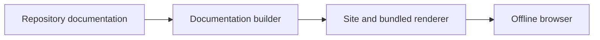
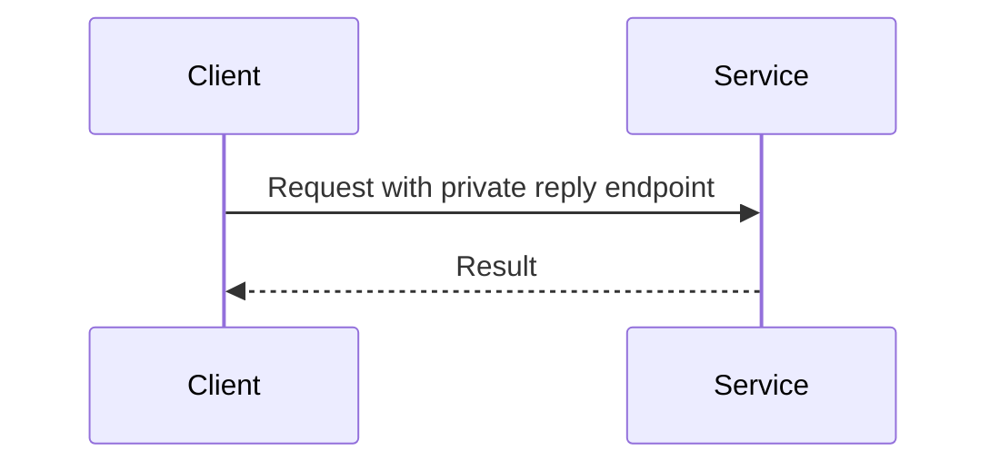

<!-- SPDX-FileCopyrightText: 2026 roolrz -->
<!-- SPDX-License-Identifier: Apache-2.0 -->

# Diagrams

Use a fenced `mermaid` block for a small architecture or sequence diagram. Every
generated site contains Mermaid 11.12.0's browser bundle and its MIT license in
`_docs_assets/`. Rendering these diagrams does not contact a CDN. The renderer
uses strict security mode; diagram source cannot enable arbitrary JavaScript.

The docs module test builds its actual site, disables networking in Chromium and
checks that these examples become visible SVG diagrams. Browser downloads happen
when preparing the test environment; they are not required to publish a site or
view its diagrams. The theme's optional syntax-highlighting resources are
independent of the bundled diagram renderer.
